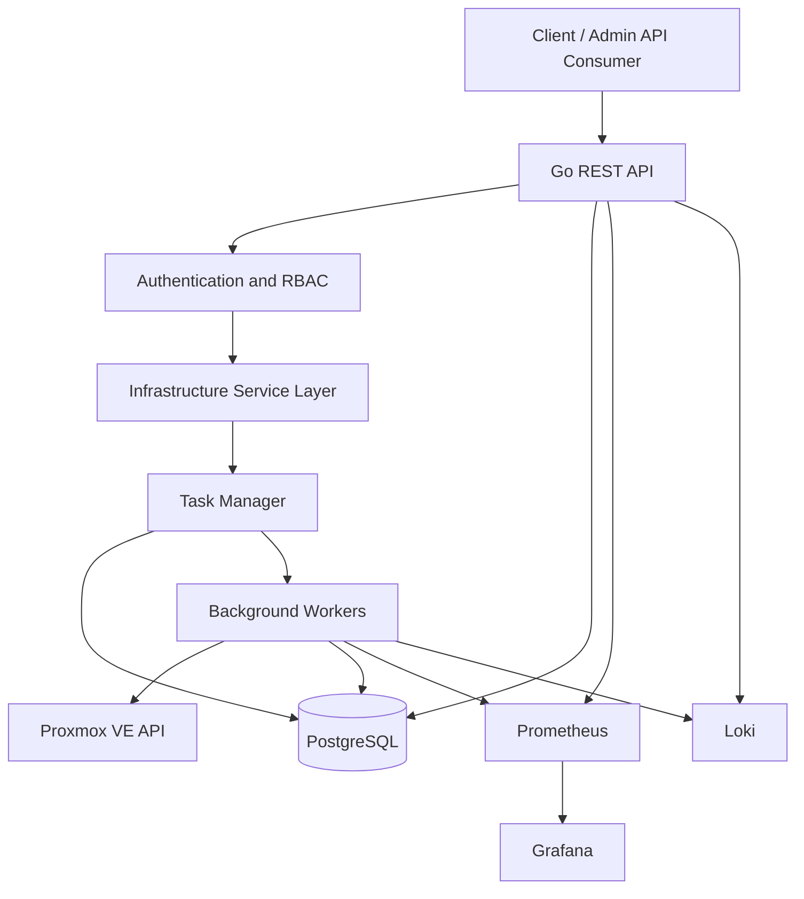

# VPS Automation Platform

**An infrastructure automation platform for provisioning and managing virtual servers on Proxmox VE using Go.**

VPS Automation Platform is a personal infrastructure engineering project focused on automating the lifecycle of virtual servers through a REST API. It aims to bridge backend application development and virtualization infrastructure by providing a centralized interface for provisioning, monitoring, and managing virtual machines (VMs) and Linux containers (LXC).

The project is being developed to explore practical challenges in infrastructure automation, virtualization, distributed task processing, resource management, and production-oriented backend engineering.

> **Project status:** In Development  
> **Primary language:** Go  
> **Virtualization platform:** Proxmox VE  
> **Initial deployment model:** Standalone Proxmox node

---

## Table of Contents

- [Overview](#overview)
- [Motivation](#motivation)
- [Key Objectives](#key-objectives)
- [Planned Features](#planned-features)
- [System Architecture](#system-architecture)
- [Technology Stack](#technology-stack)
- [Core Engineering Challenges](#core-engineering-challenges)
- [Development Roadmap](#development-roadmap)
- [Getting Started](#getting-started)
- [Project Structure](#project-structure)
- [Design Principles](#design-principles)
- [Current Limitations](#current-limitations)
- [Author](#author)

---

## Overview

Managing virtual servers manually becomes increasingly difficult as the number of workloads grows. Provisioning, configuring, monitoring, and decommissioning servers require consistent workflows, reliable error handling, and proper resource management.

This project explores how to build an automation layer on top of Proxmox VE that exposes infrastructure operations through a Go-based REST API.

The intended workflow is:

1. A client submits a request to provision a virtual server.
2. The API authenticates the request and validates resource limits.
3. The system selects an appropriate Proxmox node and prepares a provisioning task.
4. A background worker executes the operation through the Proxmox API.
5. The task status and resulting resource metadata are persisted.
6. The client retrieves the operation status and the resulting server information.

Long-running infrastructure operations are designed to be asynchronous, so API requests do not need to remain open while a virtual machine or container is being created.

## Motivation

The project is intended to demonstrate practical engineering skills across several areas:

- **Backend engineering:** REST API design, authentication, authorization, PostgreSQL, and asynchronous processing.
- **Infrastructure engineering:** Proxmox VE, KVM virtual machines, LXC containers, Linux administration, and networking.
- **Reliability engineering:** Idempotency, retries, timeouts, failure recovery, and audit logging.
- **Observability:** Metrics collection, dashboards, centralized logging, and operational troubleshooting.
- **System design:** Separation of concerns, task lifecycle management, resource allocation, and extensible architecture.

Rather than building a CRUD application alone, the project focuses on automating operations against a real virtualization platform and handling the failure scenarios associated with infrastructure provisioning.

## Key Objectives

- Build a Go REST API that integrates with Proxmox VE.
- Automate VM and LXC lifecycle operations.
- Execute long-running infrastructure operations asynchronously.
- Track task states and persist resource metadata.
- Implement authentication, role-based access control, and audit logging.
- Improve reliability through timeouts, retries, and idempotent request handling.
- Introduce monitoring and centralized logging.
- Provide reproducible deployment instructions, integration tests, and performance measurements.

## Planned Features

The following capabilities define the intended scope of the project. They are not all implemented yet.

| Feature | Description | Status |
|---|---|---|
| Proxmox integration | Communicate with Proxmox VE through its API | Planned |
| VM lifecycle management | Create, start, stop, restart, and delete VMs | Planned |
| LXC lifecycle management | Provision and manage Linux containers | Planned |
| Asynchronous tasks | Execute long-running operations in background workers | Planned |
| Task tracking | Track operation status, errors, and execution results | Planned |
| Resource metadata | Persist server configuration and ownership in PostgreSQL | Planned |
| Authentication & RBAC | Authenticate users and authorize infrastructure operations | Planned |
| Idempotency | Prevent duplicate resource creation caused by repeated requests | Planned |
| Snapshots & rollback | Support recovery workflows where compatible with the resource type | Planned |
| Audit logging | Record infrastructure operations and their actors | Planned |
| Observability | Collect application and infrastructure metrics and logs | Planned |
| Automated testing | Unit tests, integration tests, and failure scenario tests | Planned |

Feature status will be updated as implementation progresses.

## System Architecture

The initial architecture separates the API layer, task execution, infrastructure integration, persistence, and observability.



*This diagram describes the target architecture, not a claim that all components are currently implemented.*

### Component Responsibilities

**1. REST API**

Provides endpoints for infrastructure operations, request validation, authentication, authorization, and task status retrieval.

**2. Infrastructure Service Layer**

Encapsulates provisioning workflows, resource validation, lifecycle rules, and interactions with the task manager.

**3. Task Manager and Workers**

Execute long-running operations outside the synchronous request path. Tasks maintain explicit states so that clients can observe progress and failures.

**4. Proxmox Integration**

Communicates with Proxmox VE to manage virtual machines and Linux containers. Proxmox API task identifiers and operation results can be used to track asynchronous operations.

**5. PostgreSQL**

Stores application-managed metadata, task records, resource ownership, and audit events. Proxmox remains responsible for the actual virtualization resources.

**6. Observability**

Prometheus and Grafana are intended to provide metrics and dashboards. Loki is intended to support centralized log exploration.

## Technology Stack

| Technology | Intended role |
|---|---|
| Go | Backend API and infrastructure automation |
| Proxmox VE | Virtualization management |
| KVM/QEMU | Full virtual machine virtualization |
| LXC | Linux system containers |
| PostgreSQL | Persistent application metadata |
| REST API | Client-to-platform communication |
| Prometheus | Metrics collection |
| Grafana | Monitoring dashboards |
| Loki | Centralized log aggregation |
| Linux | Host administration and networking |
| Docker | Supporting local development or deployment where appropriate |

The final deployment configuration will be documented as the implementation evolves.

## Core Engineering Challenges

### 1. Reliable Infrastructure Provisioning

Infrastructure operations can fail because of unavailable resources, network interruptions, invalid templates, or Proxmox API errors.

The platform is designed to distinguish between request acceptance and operation completion, expose task status, and retain actionable failure information.

### 2. Asynchronous Task Processing

Creating a VM is not equivalent to returning a database record. The actual operation may take time and may involve multiple infrastructure steps.

The task subsystem will be designed around explicit states, such as:

`PENDING → RUNNING → SUCCEEDED / FAILED`

Cancellation and retry states will be introduced only when their semantics are defined and implemented.

### 3. Idempotency and Duplicate Requests

A client may retry a request after a timeout without knowing whether the original operation succeeded.

Idempotency controls are intended to prevent repeated requests from accidentally provisioning duplicate resources.

### 4. Resource Allocation

A provisioning workflow must validate requested CPU, memory, and storage against configured limits and available capacity.

The initial implementation targets a standalone Proxmox node. Multi-node scheduling and cluster-level capacity management are potential future extensions.

### 5. Security and Isolation

Infrastructure APIs can perform privileged operations. The platform must protect Proxmox credentials, enforce application-level permissions, validate resource ownership, and avoid exposing unrestricted administrative access to clients.

LXC and VM workloads also require appropriate isolation, networking, and resource limits.

### 6. Observability and Troubleshooting

When provisioning fails, operators need to identify which request triggered the operation, which task was executing, what Proxmox returned, and where the failure occurred.

Structured logs, task correlation identifiers, metrics, and audit records are intended to make these workflows easier to investigate.

## Development Roadmap

The project follows an incremental implementation plan.

- [ ] **Phase 1 — Infrastructure Lab:** Prepare a Proxmox VE environment, configure networking, create test VMs/LXCs, and verify API access.
- [ ] **Phase 2 — Go API Foundation:** Establish project structure, configuration, request validation, error handling, and health endpoints.
- [ ] **Phase 3 — Proxmox Integration:** Implement and test core VM/LXC lifecycle operations.
- [ ] **Phase 4 — Task Processing:** Add asynchronous workers, task persistence, retries, timeouts, and idempotency.
- [ ] **Phase 5 — Security and Persistence:** Implement authentication, RBAC, resource ownership, and audit logging.
- [ ] **Phase 6 — Observability:** Integrate metrics, dashboards, and structured logging.
- [ ] **Phase 7 — Testing and Documentation:** Add integration tests, failure scenario tests, benchmark results, and reproducible deployment instructions.

Progress will be reflected in the repository as each milestone is completed.

## Getting Started

### Prerequisites

The intended development environment includes:

- Go (version to be specified in `go.mod`)
- Git
- Access to a Proxmox VE environment
- A Proxmox API identity with appropriately restricted permissions
- PostgreSQL for persistent application metadata

### Clone the Repository

```bash
git clone <repository-url>
cd <repository-directory>
```

### Configure the Environment

Create a local environment configuration file based on the project's environment template.

Typical configuration categories include:

```dotenv
APP_ENV=development
HTTP_ADDR=:8080

DATABASE_URL=postgres://<user>:<password>@localhost:5432/vps_automation

PROXMOX_API_URL=https://<proxmox-host>:8006/api2/json
PROXMOX_TOKEN_ID=<api-token-id>
PROXMOX_TOKEN_SECRET=<api-token-secret>
PROXMOX_NODE=<proxmox-node>
```

These variable names are illustrative and must match the application's actual configuration implementation.

Do not commit real credentials or disable TLS certificate verification in production.

### Run the Application

Once the application entry point, dependencies, and configuration have been implemented, the startup instructions will be documented here.

Example Go commands:

```bash
go mod download
go test ./...
go run ./cmd/api
```

The final commands and entry point will be adjusted to match the repository structure.

## Project Structure

The repository is expected to evolve toward a structure similar to the following:

```text
.
├── cmd/
│   └── api/
├── internal/
│   ├── api/
│   ├── config/
│   ├── domain/
│   ├── service/
│   ├── task/
│   ├── repository/
│   ├── proxmox/
│   └── observability/
├── migrations/
├── docs/
├── tests/
├── go.mod
└── README.md
```

This is a proposed structure, not a representation of the current source tree. Directories should be introduced as their corresponding responsibilities are implemented.

## Design Principles

- **Explicit task lifecycle:** Infrastructure operations must have observable states and well-defined outcomes.
- **Separation of concerns:** HTTP handling, business rules, persistence, and Proxmox integration should remain independently testable.
- **Least privilege:** Use restricted credentials and validate authorization before performing infrastructure operations.
- **Failure-aware workflows:** Treat network failures, timeouts, partial execution, and retries as first-class engineering concerns.
- **Reproducibility:** Document the environment and steps required to reproduce tests and deployment.
- **Measurable reliability:** Use tests, logs, metrics, and benchmarks to validate behavior instead of relying solely on assumptions.

## Current Limitations

- The project is under active development.
- The initial deployment model targets a standalone Proxmox VE node.
- Features described as planned are not necessarily available in the current codebase.
- Production readiness, security guarantees, and performance targets will be evaluated through implementation and testing.
- High availability, multi-node scheduling, and advanced cluster management are outside the initial implementation scope.

## Author

Tran Luc

**Focus areas:** Go · Linux · Proxmox VE · REST APIs · Virtualization · Infrastructure Automation · Observability
